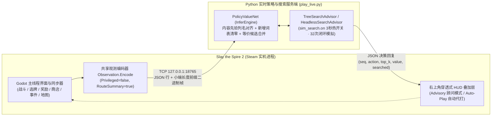

# sts2-alphadefect-bridge

[](LICENSE)
[](#2-编译与安装模组-building--installing-sts2bridge)

**`sts2-alphadefect-bridge`** 是面向 [hmty-CHEN/AlphaDefect-Public](https://github.com/hmty-CHEN/AlphaDefect-Public) 开源权重与观测体系的 **《杀戮尖塔 2》（Slay the Spire 2）实机客户端桥接模组（`Sts2Bridge`）与实时策略 / 闭环树搜索服务端（`play_live.py`）**，以纯正 **MIT 协议** 开源发布。

> **English Quickstart** is provided in [Section 8](#8-english-quickstart) below.

---

## 目录 (Table of Contents)

1. [项目架构与公平性保证](#1-项目架构与公平性保证)
2. [编译与安装模组 (v0.114.0 / v0.113.1 / v0.111.0)](#2-编译与安装模组-building--installing-sts2bridge)
3. [启动实时策略端 (`play_live.py`)](#3-启动实时策略端-play_livepy)
4. [开启 32 次模拟的 Boss / 精英战闭环树搜索 (`sim_search.on`)](#4-开启-32-次模拟的-boss--精英战闭环树搜索-sim_searchon)
5. [游戏内双模式 HUD 与快捷键 (`F8` / `F9` / `F10` / `F7`)](#5-游戏内双模式-hud-与快捷键-f8--f9--f10--f7)
6. [硬件需求与配置参数](#6-硬件需求与配置参数)
7. [自动化端到端测试 (`tests/test_play_live.py`)](#7-自动化端到端测试-teststest_play_livepy)
8. [English Quickstart](#8-english-quickstart)
9. [开源许可与第三方声明 (MIT License & Mega Crit Notice)](#9-开源许可与第三方声明-mit-license--mega-crit-notice)

---

## 1. 项目架构与公平性保证

在 [AlphaDefect-Public](https://github.com/hmty-CHEN/AlphaDefect-Public) 公开仓库中，训练引擎（`Sts2Headless`）、神经网络结构（`PolicyValueNet`）、公开权重（如愚者 `weights-v5` `fool_ema_v24181.pt` 及其他五个角色模型）和搜索模块（`headless_search.py` / `tree_live.py`）均已以 MIT 协议公开，但用于连接 Steam 正式版游戏的实机模组（`Sts2Bridge`）与实时策略驱动端（`play_live.py`）未包含在内（见上游 `NOTICE.md`）。本仓库完整补齐这一实机闭环：



### 核心特性与严格人类视野保证

- **与无头训练引擎逐位对齐的观测编码**：`Sts2Bridge` 通过 `engine/Directory.Build.targets` 直接链接并编译 AlphaDefect 的 MIT 观测编码器（`Observation.cs`、`Engine/Obs/**`、`Engine/Compat/**`），包含：
  - **v0.114.0 有目标伤害预览口径补丁（`Observation.RawPreview`）**：仅在 `Observation.Encode` 编码瞬间将 `CreatureCmd.GetDamageResultsPreview` 保持在“掉血钩子之前”的基线，不改动任何实机结算或界面显示；
  - **已知抽牌堆顶跟踪（`Observation.DrawTop`）**：通过 `CardPileCmd.Add` / `CardPile` 钩子仅记录被公开效果明确放到牌堆顶部的卡牌（区域 16–18）；
  - **事件选项合并变量剥离（`StripMergedEventVars`）**：在编码瞬间还原 `NEventOptionButton._Ready` 合并进选项描述的全局事件变量，使事件帧与 `Sts2Headless` 完全一致；
  - **词表别名兼容（`aliases.txt`）**：支持 `v0.114.0` 的 `CARD.TWIN_SHOT → CARD.RAPID_SHOT` 等跨版本同义映射。
- **100% 人类可见信息（绝不作弊）**：
  - 实机端固定 `Observation.Privileged = false`、`Observation.FutureContent = false`、`Observation.Oracle = false`，抽牌堆未知部分严格按卡牌词表 ID 字典序输出；
  - Python 端推理前再次强制 `ragged.tok_priv[:] = 0`；
  - 开启树搜索时，开局种子（游戏右上角公开显示）仅用于镜像重放“已经发生过的历史步”，每次推演在分支前立即 `reseed` 重置全部未来随机数并重洗未知抽牌堆。
- **安全双模式运行**：默认以 **Advisory（顾问叠加层）模式** 启动，仅在右上角渲染鼠标完全穿透的策略建议面板，不自动点击任何按钮；按 **`F8`** 可随时切换 **Auto-Play（全自动出牌）**，按 **`F9`** 在顾问模式下单步执行当前推荐动作。

---

## 2. 编译与安装模组 (Building & Installing `Sts2Bridge`)

### 环境要求

- **.NET 9.0 SDK**（`dotnet --version` ≥ 9.0）
- 本地正版 Steam 安装的 **《杀戮尖塔 2》（Slay the Spire 2）**（编译时仅只读引用游戏目录下的 `sts2.dll`、`GodotSharp.dll`、`0Harmony.dll`，`Private=false`，绝不复制或分发游戏文件）

### 方式一：一键编译并安装到游戏 `mods/Sts2Bridge/` 目录（推荐）

```bash
# 默认按 v0.114.0 编译并复制模组文件到 <游戏根目录>/mods/Sts2Bridge/
python3 tools/install_mod.py --game-dir "/path/to/Steam/steamapps/common/Slay the Spire 2"

# 若你的游戏版本为 v0.113.1 或 v0.111.0，显式指定 --game-version：
python3 tools/install_mod.py \
  --game-dir "/path/to/Steam/steamapps/common/Slay the Spire 2" \
  --game-version v0.113.1
```

Windows PowerShell 示例：

```powershell
python tools\install_mod.py --game-dir "C:\Program Files (x86)\Steam\steamapps\common\Slay the Spire 2"
```

### 方式二：手动使用 `dotnet build` 多版本编译

`engine/Directory.Build.props` 会根据 `Sts2GameVersion` 自动设置条件编译符号（`STS2_V0114` / `STS2_V0113` / `STS2_V0111`）并选择匹配的观测编码树：

```bash
# 1. 编译 v0.114.0（默认版本，含 RawPreview 伤害预览口径补丁与 Optimism / TwinShot 支持）
dotnet build engine/Sts2Bridge/Sts2Bridge.csproj -c Release \
  -p:Sts2GameVersion=v0.114.0 \
  -p:Sts2GameDir="/path/to/Slay the Spire 2/data_sts2_windows_x86_64"

# 2. 编译 v0.113.1 / v0.113.0（公开论文主线版本）
dotnet build engine/Sts2Bridge/Sts2Bridge.csproj -c Release \
  -p:Sts2GameVersion=v0.113.1 \
  -p:Sts2GameDir="/path/to/game/v0.113.1"

# 3. 编译 v0.111.0（早期评测基线版本）
dotnet build engine/Sts2Bridge/Sts2Bridge.csproj -c Release \
  -p:Sts2GameVersion=v0.111.0 \
  -p:Sts2GameDir="/path/to/game/v0.111.0"
```

编译产物位于 `engine/Sts2Bridge/bin/Release/net9.0/`，将以下 6 个文件复制到 `<Slay the Spire 2>/mods/Sts2Bridge/` 即可：

```text
<Slay the Spire 2>/mods/Sts2Bridge/
├── Sts2Bridge.dll
├── Sts2Bridge.json
├── bridge_config.json
├── vocab.txt
├── aliases.txt
└── no_downside_relics.txt
```

启动游戏并在主菜单 **Mods（模组）** 界面确认勾选启用 `AlphaDefect Live Bridge (Sts2Bridge)`。

---

## 3. 启动实时策略端 (`play_live.py`)

### Python 依赖

```bash
pip install numpy torch
```

### 下载公开模型权重

从 [hmty-CHEN/AlphaDefect-Public Releases](https://github.com/hmty-CHEN/AlphaDefect-Public/releases) 下载对应角色的 `.pt` 检查点（例如 `weights-v5` 中的愚者滑动平均权重 `fool_ema_v24181.pt`，或故障机器人、静默猎手、铁甲战士、亡灵契约师、储君权重）。

### 启动服务

在仓库根目录下运行（以便自动读取 `engine/game_version.txt` 与 `engine/catalog/`）：

```bash
# 使用愚者 v24181 权重启动实时策略服务（默认监听 127.0.0.1:18765）
python3 python/play_live.py --ckpt /path/to/fool_ema_v24181.pt --device cuda

# 纯 CPU 推理同样流畅（单步前向仅需数毫秒至数十毫秒）
python3 python/play_live.py --ckpt /path/to/fool_ema_v24181.pt --device cpu --threads 4

# 监控目录并在每局开始/结束时自动热更新最新 .pt 权重
python3 python/play_live.py --ckpt-dir /path/to/checkpoints/ --device cuda
```

`play_live.py` 启动时会自动完成：
1. **跨版本内容先验按特征名对齐**（`load_state(..., ckpt.get("content_names"))`，例如在 `v0.114.0` 1,196 列目录下载入 `v0.113.1` 1,195 列检查点时精确对齐 1,190 列、6 列新增特征置零，避免末尾补零错位）；
2. **新增词表嵌入清零**（`zero_new_vocab`，例如词表从 `2,557` 扩至 `2,559` 时自动清零新牌嵌入行，同时保留旧版 `<unk>` 语义行）；
3. **等价动作概率合并贪心**（`sts2rl.greedy.merged_argmax`：手里有多张完全相同的牌时按等价类合并概率后再取最大，避免概率被同类牌分摊）。

---

## 4. 开启 32 次模拟的 Boss / 精英战闭环树搜索 (`sim_search.on`)

`play_live.py` 原生集成 AlphaDefect 的闭环信息集树搜索（`TreeSearchAdvisor` / `HeadlessSearchAdvisor`）。树搜索需要一份编译好的 `AlphaDefect-Public` 无头引擎 `Sts2Headless.dll`（带 `Engine/Clone` 局面复制支持，用于跟着实机做同步镜像并在推演进程中 `restore + reseed` 分支推演）。

### 方式一：通过哨兵文件 `sim_search.on` 动态热开关（无需重启 `play_live.py`）

`play_live.py` 每 **3 秒** 检查一次当前目录 `./sim_search.on`（或 `~/.local/share/sls2/live/sim_search.on`，亦可通过 `--sentinel` 指定）：

```bash
# 开启三幕 Boss 与精英战 32 次模拟树搜索（下一局开局起镜像同步生效）
cat > sim_search.on <<'EOF'
{
  "method": "tree",
  "scope": "boss_elite",
  "sims": 32,
  "tree_procs": 8,
  "dll": "/path/to/AlphaDefect-Public/game-v0.114.0/engine/Sts2Headless/bin/Release/net9.0/Sts2Headless.dll"
}
EOF

# 随时关闭树搜索（即使在战斗中途删除也立即回退到纯网络贪心）
rm -f sim_search.on
```

支持的 `scope` 范围：
| `scope` | 搜索范围 | 说明 |
|---|---|---|
| `"boss_elite"` | 全部三幕的精英战与 Boss 战 | **推荐默认设置**（AlphaDefect 离线 3,000 局配对实测胜率 `62.13% → 68.37%`） |
| `"boss"` | 全部三幕的 Boss 战 | 仅在 Boss 战启用深度推演 |
| `"act3_boss"` | 仅第三幕双 Boss 战 | 仅在终幕 Boss 启用 |
| `"all"` | 所有普通战、精英战与 Boss 战 | 全程战斗搜索 |

### 方式二：命令行参数直接开启

```bash
python3 python/play_live.py \
  --ckpt /path/to/fool_ema_v24181.pt \
  --tree-search boss_elite \
  --sims 32 \
  --headless-dll /path/to/Sts2Headless.dll
```

> **注意**：镜像进程需要从一局的起点（第 0 层）跟着实机同步推进；中途读档续玩（`loaded_floor > 0`）或中途才开启哨兵的那一局会自动回退为网络贪心策略，从新开局起正式启用树搜索。

---

## 5. 游戏内双模式 HUD 与快捷键 (`F8` / `F9` / `F10` / `F7`)

模组加载后会在游戏右上角（顶栏遗物下方）渲染一块半透明、**鼠标点击完全穿透**的状态叠加层：

- **蓝框 `ADVISORY`（默认安全顾问模式）**：仅实时展示推荐动作、前 3 个候选动作的概率分布、局面价值估计 `V` 与估算胜率 `Win≈%`，由玩家自己操作鼠标或按 `F9` 单步采纳。
- **绿框 `AUTO-PLAY`（自动代打模式）**：在每个稳定决策点等待 `action_delay_ms`（默认 `250ms`）后自动执行策略返回的动作（严格校验 `seq` 序号，过期的旧回复自动丢弃）。
- **金框 `[TREE OVERRIDE] / [TREE CONFIRMED]`**：当 Boss / 精英战触发闭环树搜索时，边框变为金色并显示模拟次数、耗时以及树搜索是否推翻了原网络贪心首选。

| 快捷键 | 功能 |
|---|---|
| **`F8`** | 切换 **`ADVISORY`（顾问提示）** 与 **`AUTO-PLAY`（全自动代打）** 模式 |
| **`F9`** | 在 `ADVISORY` 模式下**单步执行一次**当前推荐动作 |
| **`F10`** | 立即强制重连 `play_live.py` TCP 服务端（重连后自动补发当前对局 `run_info`） |
| **`F7`** | 显示 / 隐藏右上角 HUD 面板 |

### `bridge_config.json` 与环境变量

位于 `<Slay the Spire 2>/mods/Sts2Bridge/bridge_config.json`：

```json
{
  "host": "127.0.0.1",
  "port": 18765,
  "auto_play": false,
  "action_delay_ms": 250,
  "stabilize_ms": 120,
  "route_summary": true,
  "auto_gold": true,
  "auto_free_relics": true,
  "show_overlay": true
}
```

可用环境变量覆盖：`STS2_BRIDGE_HOST`、`STS2_BRIDGE_PORT`、`STS2_BRIDGE_AUTO=1`、`STS2_BRIDGE_DELAY_MS`。

---

## 6. 硬件需求与配置参数

- **仅策略网络实时推理（默认模式）**：
  - **CPU 即可流畅运行**：任意现代 4 核以上 CPU、内存 ≥ 2 GB，单步推理耗时约 `3–30 ms`（GPU 上约 `1–5 ms`）。
- **开启 32 次模拟闭环树搜索（`boss_elite`）**：
  - 建议 **8 核以上 CPU**、空闲内存 **≥ 4 GB**（1 个镜像无头引擎进程 + 默认 8 个推演工作进程约占 `2.4–2.9 GB` 内存）；
  - 若内存或核心较少，可在 `sim_search.on` 中调小 `"tree_procs": 4`、`"sims": 16`。

---

## 7. 自动化端到端测试 (`tests/test_play_live.py`)

仓库内置完整的端到端自动化测试脚本，无需启动 Steam 客户端即可在本地临时端口拉起真实的 `play_live.py`，模拟 `Sts2Bridge` 发送 `hello`、`run_info`、愚者（`FOOL`）格式 27 战斗帧（含重复打击牌等价类合并验证与特权特征清零验证）、带路线摘要的地图帧、动态 `sim_search.on` 哨兵切换与 `run_end`，并校验真实神经网络输出：

```bash
python3 tests/test_play_live.py --ckpt /path/to/fool_ema_v24181.pt --device cpu
```

---

## 8. English Quickstart

**`sts2-alphadefect-bridge`** provides the missing MIT-licensed real-game client mod (`Sts2Bridge`) and live TCP policy / tree-search driver (`python/play_live.py`) for [hmty-CHEN/AlphaDefect-Public](https://github.com/hmty-CHEN/AlphaDefect-Public) in *Slay the Spire 2* (`v0.111.0` – `v0.114.0`).

### Step 1: Build & Install the `Sts2Bridge` Mod

Requires **.NET 9.0 SDK** and your local Steam installation of *Slay the Spire 2*:

```bash
# Builds Sts2Bridge.dll (default v0.114.0; pass --game-version v0.113.1 or v0.111.0 if needed)
# and installs Sts2Bridge.{dll,json}, bridge_config.json, vocab.txt, aliases.txt, no_downside_relics.txt
# into <Slay the Spire 2>/mods/Sts2Bridge/
python3 tools/install_mod.py --game-dir "/path/to/Steam/steamapps/common/Slay the Spire 2"
```

### Step 2: Run the Live Policy Server (`play_live.py`)

Download a `.pt` checkpoint from [AlphaDefect-Public Releases](https://github.com/hmty-CHEN/AlphaDefect-Public/releases) (e.g., `fool_ema_v24181.pt` from `weights-v5`), install `numpy` and `torch`, and run from the repository root:

```bash
python3 python/play_live.py --ckpt /path/to/fool_ema_v24181.pt --device cuda
```

Optional **32-simulation Boss/Elite Tree Search** (polled live every 3 seconds without restarting):

```bash
echo '{"method": "tree", "scope": "boss_elite", "sims": 32, "dll": "/path/to/Sts2Headless.dll"}' > sim_search.on
# Delete sim_search.on at any time to immediately return to greedy network play:
rm -f sim_search.on
```

### Step 3: Launch *Slay the Spire 2*

Enable **AlphaDefect Live Bridge** in the in-game **Mods** menu. Use hotkeys at any time:
- **`F8`**: Toggle between **Advisory Mode** (default safe HUD overlay) and **Auto-Play Mode**
- **`F9`**: Execute a single recommended action in Advisory Mode
- **`F10`**: Reconnect TCP link (`127.0.0.1:18765`)
- **`F7`**: Show / Hide the top-right HUD overlay

---

## 9. 开源许可与第三方声明 (MIT License & Mega Crit Notice)

- 本仓库所有源代码、脚本、测试与文档均基于 **[MIT License](LICENSE)** 开源发布：
  - 共享观测编码器、兼容层、协议解析、网络结构与树搜索模块改编自 [hmty-CHEN/AlphaDefect-Public](https://github.com/hmty-CHEN/AlphaDefect-Public)（`Copyright (c) 2026 Qiyue Chen`，MIT License；本仓库**不包含**任何 `PerfPatches.cs` 代码）。
  - 实机客户端桥接模组 `Sts2Bridge`、实时策略驱动端 `play_live.py`、HUD 叠加层、多版本构建配置与端到端测试由本仓库作者完成（`Copyright (c) 2026 Kurisu934 and Contributors`，MIT License）。
- **第三方权利声明（详见 [NOTICE.md](NOTICE.md)）**：
  - **《杀戮尖塔 2》（Slay the Spire 2）** 是 **Mega Crit Games** 的财产与注册商标，本项目与 Mega Crit Games 无任何官方关联。
  - 本仓库**不包含**任何游戏二进制文件（`sts2.dll`、`GodotSharp.dll`、`0Harmony.dll`、`.pck`）、游戏美术音频资源、反编译源码或模型权重文件。用户须自行提供合法购买的本地 Steam 游戏目录（`Sts2GameDir`）进行编译与运行。
