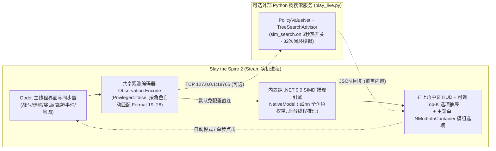

# sts2-alphadefect-bridge

[](LICENSE)
[](https://github.com/Kurisu934/sts2-alphadefect-bridge/releases)
[](#1-三步安装整合包免-python开箱即用)

**`sts2-alphadefect-bridge`** 是面向 [hmty-CHEN/AlphaDefect-Public](https://github.com/hmty-CHEN/AlphaDefect-Public) 开源权重与观测体系的 **《杀戮尖塔 2》（Slay the Spire 2）全功能实机 AI 预测与自动打牌模组（`Sts2Bridge` v1.1.0）+ 可选实时闭环树搜索服务端（`play_live.py`）**，以纯正 **MIT 协议** 开源发布。

### v1.1.0 核心亮点

- **零配置开箱即用（无需安装 Python / PyTorch）**：内置纯 `.NET 9.0` 跨平台硬件 SIMD 神经网络推理引擎（`NativeModel.cs`），整合包内已预置 **全部 6 位角色**（愚者 `FOOL`、铁甲战士 `IRONCLAD`、亡灵契约师 `NECROBINDER`、静默猎手 `SILENT`、储君 `REGENT`、故障机器人 `DEFECT`）的最优模型权重（`.s2nn`），支持 **Windows (`x64`) / macOS (`Apple Silicon arm64` & `x86_64`) / Linux (`x64`)** 解压即玩！
- **局内实时查看下一步推荐与胜率**：右上角半透明穿透式中文面板（自动加载游戏内置中文字体，绝不遮挡正常鼠标点击）实时展示 **下一步推荐动作、视觉化概率条、预计通关胜率、局面价值估计**。
- **双入口可交互模组选项（可调 `Top-K` 候选数 + `自动模式`）**：
  1. **游戏原生 Mods（模组）界面**：选中 `AlphaDefect AI 助手 (Sts2Bridge)` 即可在下方 **`⚙ 模组选项 · AI 预测与自动模式`** 面板中直接拖动滑条调整 **`Top-K`（1–10）**、开关 **自动模式**、调节 **自动出牌间隔（50–1500 ms）** 与切换推理引擎；
  2. **局内右上角悬浮工具栏**：随时点击面板顶部的 **`[自动: 关/开]`**、**`[单步]`** 或 **`[⚙ 选项]`** 展开内嵌滑条，在战斗中途实时增减 `Top-K` 候选展示数量，立即生效并自动保存到 `bridge_config.json`！
- **无缝衔接外部 32 次模拟树搜索**：默认 `"auto"` 模式下，未启动外部服务时自动使用内置 `.s2nn` 模型毫秒级推理；若在后台启动 `python/play_live.py`（可随时通过 `sim_search.on` 开启三幕精英与 Boss 战 32 次闭环模拟树搜索），模组自动切换至外部树搜索服务！

> **English Quickstart** is available in [Section 8](#8-english-quickstart) below.

---

## 目录 (Table of Contents)

1. [三步安装整合包（免 Python，开箱即用）](#1-三步安装整合包免-python开箱即用)
2. [游戏内模组选项、HUD 预测面板与快捷键](#2-游戏内模组选项hud-预测面板与快捷键)
3. [项目架构与 100% 人类视野保证](#3-项目架构与-100-人类视野保证)
4. [从源码编译模组与导出 `.s2nn` 权重](#4-从源码编译模组与导出-s2nn-权重)
5. [进阶：启动 Python 服务端开启 32 次模拟闭环树搜索 (`play_live.py`)](#5-进阶启动-python-服务端开启-32-次模拟闭环树搜索-play_livepy)
6. [硬件需求与配置参数](#6-硬件需求与配置参数)
7. [自动化数值等价校验与端到端测试](#7-自动化数值等价校验与端到端测试)
8. [English Quickstart](#8-english-quickstart)
9. [开源许可与第三方声明 (MIT License & Mega Crit Notice)](#9-开源许可与第三方声明-mit-license--mega-crit-notice)

---

## 1. 三步安装整合包（免 Python，开箱即用）

1. 前往 **[GitHub Releases](https://github.com/Kurisu934/sts2-alphadefect-bridge/releases/latest)** 下载 **`Sts2Bridge-v0.114.0-ReadyToUse.zip`**（适用于《杀戮尖塔 2》`v0.114.0`）。
2. 解压缩后，将里面的 **`Sts2Bridge`** 文件夹完整放入游戏的 `mods/` 目录下：
   - **Windows (Steam)**：`<Steam>\steamapps\common\Slay the Spire 2\mods\Sts2Bridge\`
   - **macOS (Steam)**：`~/Library/Application Support/Steam/steamapps/common/Slay the Spire 2/SlayTheSpire2.app/Contents/MacOS/mods/Sts2Bridge/`
   - **Linux (Steam)**：`~/.local/share/Steam/steamapps/common/Slay the Spire 2/mods/Sts2Bridge/`

   目录结构如下：
   ```text
   mods/Sts2Bridge/
   ├── Sts2Bridge.dll
   ├── Sts2Bridge.json
   ├── bridge_config.json
   ├── vocab.txt
   ├── aliases.txt
   ├── no_downside_relics.txt
   └── models/
       ├── FOOL.s2nn          (v24181 · 愚者)
       ├── IRONCLAD.s2nn      (v24782 · 铁甲战士 · 含 2-pass Recycle 回灌)
       ├── NECROBINDER.s2nn   (v25875 · 亡灵契约师)
       ├── SILENT.s2nn        (v26428 · 静默猎手)
       ├── REGENT.s2nn        (v54603 · 储君)
       └── DEFECT.s2nn        (v165018 · 故障机器人 · 含 HL-Gauss 分类价值头)
   ```
3. 启动《杀戮尖塔 2》，进入主菜单 **Mods（模组）** 界面确认启用 **`AlphaDefect AI 助手 (Sts2Bridge)`**，即可直接点击配置选项并开始任意角色对局！

---

## 2. 游戏内模组选项、HUD 预测面板与快捷键

### 方式一：主菜单 `Mods` 界面直接设置

在游戏主菜单打开 **Mods** 页面并点击 `AlphaDefect AI 助手 (Sts2Bridge)`，右侧底部会自动出现 **`⚙ 模组选项 · AI 预测与自动模式`** 交互面板：
- **预测候选数量 (`Top-K`)**：支持滑条或 `[-]` / `[+]` 在 **`Top-1` ～ `Top-10`** 之间自由调节（默认 `Top-3`）；
- **自动模式 (`Auto-Play`)**：一键切换 **仅显示预测建议（默认安全模式）** 或 **全自动执行最优动作**；
- **自动出牌间隔**：`50 ms` ～ `1500 ms`（步进 `50 ms`，默认 `250 ms`）；
- **推理引擎**：在 `自动 (内置兜底/外部优先)`、`仅内置模型 (免配置)`、`仅外部服务 (Python)` 之间切换；
- **局内右上角预测面板**：开启或隐藏右上角 HUD。

### 方式二：局内右上角悬浮工具栏与快捷键

进入对局后，右上角面板除文字区域完全**鼠标穿透**外，顶部提供三个轻量按钮：
- **`[自动: 关 / 开]`**：点击（或按 **`F8`**）即时切换辅助预测模式与全自动代打模式；
- **`[单步]`**：点击（或按 **`F9`**）在辅助模式下让 AI 代执行当前这一步推荐动作；
- **`[⚙ 选项]`**：点击即在局内原地展开 `Top-K` 滑条、自动延迟滑条与引擎切换按钮，拖动 `Top-K` 时下方候选列表**实时增减**！

| 快捷键 | 功能 |
|---|---|
| **`F8`** | 切换 **`辅助预测`** 与 **`自动模式`** |
| **`F9`** | 在辅助模式下**单步执行一次**当前推荐动作 |
| **`F7`** | 显示 / 隐藏右上角预测面板 |
| **`F10`** | 强制重连外部 `play_live.py` TCP 服务端 |

---

## 3. 项目架构与 100% 人类视野保证



- **逐位对齐训练引擎观测**：直接链接编译 AlphaDefect 的 MIT 观测编码器（含 `v0.114.0` 的 `Observation.RawPreview` 有目标伤害预览基线补丁、`Observation.DrawTop` 已知牌堆顶跟踪、`StripMergedEventVars` 事件变量还原、`aliases.txt` 同义映射），并根据当前角色模型自动切换 `Observation.FormatOverride`（故障机器人 `19`、储君 `20`、静默猎手 `23`、愚者 `27`、铁甲战士与亡灵契约师 `28`）。
- **严格人类可见信息（绝不读取隐藏随机数）**：固定 `Observation.Privileged = false`、`FutureContent = false`、`Oracle = false`，未知抽牌堆严格按词表 ID 排序，内置 `NativeModel` 与外部 `play_live.py` 均强制忽略 `tok_priv`。
- **等价动作合并贪心（`merged_argmax`）**：C# 内置引擎与 Python 服务端均完整实现等价候选概率合并，手中多张同名同属性手牌不会被拆分稀释概率。

---

## 4. 从源码编译模组与导出 `.s2nn` 权重

### 环境要求

- **.NET 9.0 SDK**（`dotnet --version` ≥ 9.0）
- 本地正版 Steam 安装的 **《杀戮尖塔 2》**（仅只读引用 `sts2.dll`、`GodotSharp.dll`、`0Harmony.dll`，`<Private>false</Private>`，不复制任何游戏 DLL）

### 编译并安装模组（支持 `v0.114.0` / `v0.113.1` / `v0.111.0`）

```bash
# 一键编译并安装到 <游戏根目录>/mods/Sts2Bridge/（自动识别 Windows / macOS .app / Linux 目录结构）
python3 tools/install_mod.py \
  --game-dir "/path/to/Steam/steamapps/common/Slay the Spire 2" \
  --models-dir "/path/to/exported_s2nn_models"

# 或手动调用 dotnet build 指定游戏版本：
dotnet build engine/Sts2Bridge/Sts2Bridge.csproj -c Release \
  -p:Sts2GameVersion=v0.114.0 \
  -p:Sts2GameDir="/path/to/Slay the Spire 2/data_sts2_windows_x86_64"
```

### 将公开 `.pt` 检查点导出为内置 `.s2nn` 模型 (`tools/export_s2nn.py`)

```bash
# 单个检查点导出
python3 tools/export_s2nn.py \
  --ckpt /path/to/fool_ema_v24181_v0114_aligned.pt \
  --out mods/Sts2Bridge/models/FOOL.s2nn

# 批量导出全部 6 个角色并生成 PyTorch 对拍真值向量
python3 tools/export_s2nn.py \
  --all-dir /path/to/all_best_pts \
  --out-dir mods/Sts2Bridge/models \
  --verify-out /tmp/verify_cases.json
```

---

## 5. 进阶：启动 Python 服务端开启 32 次模拟闭环树搜索 (`play_live.py`)

内置 `.s2nn` 模型提供极速纯网络贪心推理；若希望在精英战与 Boss 战进一步开启 **32 次闭环模拟信息集树搜索**（需编译带 `Clone` 模块的无头引擎 `Sts2Headless.dll`），只需在后台启动 `play_live.py`，模组在 `"auto"` 引擎模式下会自动检测连接并无缝切换：

```bash
python3 python/play_live.py \
  --ckpt /path/to/fool_ema_v24181.pt \
  --tree-search boss_elite \
  --sims 32 \
  --headless-dll /path/to/Sts2Headless.dll
```

也可通过当前目录哨兵文件 `sim_search.on` 每 3 秒热开关树搜索（删除 `sim_search.on` 即刻回退纯网络贪心）：

```bash
echo '{"method": "tree", "scope": "boss_elite", "sims": 32, "dll": "/path/to/Sts2Headless.dll"}' > sim_search.on
```

---

## 6. 硬件需求与配置参数

- **内置 `.s2nn` 引擎模式（默认免配置）**：任意支持《杀戮尖塔 2》的电脑均可零卡顿运行（额外内存占用仅约 `55 MB`，后台工作线程单步推理耗时约 `3–15 ms`，完全不占用主渲染线程）。
- **外部 32 次模拟树搜索模式**：建议 8 核以上 CPU、空闲内存 ≥ 4 GB。

### `bridge_config.json` 说明

```json
{
  "host": "127.0.0.1",
  "port": 18765,
  "backend": "auto",
  "top_k": 3,
  "auto_play": false,
  "action_delay_ms": 250,
  "stabilize_ms": 120,
  "route_summary": true,
  "auto_gold": true,
  "auto_free_relics": true,
  "show_overlay": true
}
```

---

## 7. 自动化数值等价校验与端到端测试

```bash
# 1. 校验全部 6 个角色在 C# NativeModel 与 PyTorch PolicyValueNet.forward_infer 下的输出概率差 (< 3e-3)、Top-K 排序与动作完全一致
python3 tests/verify_native_parity.py \
  --models-dir /path/to/s2nn_models \
  --verify-json /tmp/verify_cases.json \
  --bridge-dll engine/Sts2Bridge/bin/Release/net9.0/Sts2Bridge.dll \
  --game-dir /path/to/sts2_managed_dir

# 2. 校验 play_live.py TCP 协议与真实检查点端到端推理
python3 tests/test_play_live.py --ckpt /path/to/fool_ema_v24181.pt --device cpu
```

---

## 8. English Quickstart

### Option A: Zero-Python Turnkey Mod (`Sts2Bridge-v0.114.0-ReadyToUse.zip`)

1. Download **`Sts2Bridge-v0.114.0-ReadyToUse.zip`** from [GitHub Releases](https://github.com/Kurisu934/sts2-alphadefect-bridge/releases/latest).
2. Extract the `Sts2Bridge/` folder into your game's `mods/` directory:
   - **Windows**: `<Steam>\steamapps\common\Slay the Spire 2\mods\Sts2Bridge\`
   - **macOS**: `SlayTheSpire2.app/Contents/MacOS/mods/Sts2Bridge/`
   - **Linux**: `<Steam>/steamapps/common/Slay the Spire 2/mods/Sts2Bridge/`
3. Launch *Slay the Spire 2* and enable **AlphaDefect AI 助手 (Sts2Bridge)** in the **Mods** menu.
   - Adjust **Top-K (`1..10`)**, **Auto-Play**, and **Action Delay** directly in the Mod menu panel or via the in-run top-right **`[⚙ 选项]`** button!
   - Hotkeys: **`F8`** toggle Auto-Play / Advisory, **`F9`** single step, **`F7`** show/hide HUD, **`F10`** reconnect TCP.

### Option B: Build from Source & Optional Live Tree Search

```bash
python3 tools/install_mod.py --game-dir "/path/to/Slay the Spire 2"
python3 tools/export_s2nn.py --all-dir /path/to/pts --out-dir "/path/to/Slay the Spire 2/mods/Sts2Bridge/models"

# Optional external 32-sim Boss/Elite Tree Search server:
python3 python/play_live.py --ckpt /path/to/fool_ema_v24181.pt --tree-search boss_elite --sims 32 --headless-dll /path/to/Sts2Headless.dll
```

---

## 9. 开源许可与第三方声明 (MIT License & Mega Crit Notice)

- 本仓库所有源代码、脚本、测试与文档均基于 **[MIT License](LICENSE)** 开源发布：
  - 共享观测编码器、兼容层、协议解析、网络结构与树搜索模块改编自 [hmty-CHEN/AlphaDefect-Public](https://github.com/hmty-CHEN/AlphaDefect-Public)（`Copyright (c) 2026 Qiyue Chen`，MIT License；本仓库**不包含**任何 `PerfPatches.cs` 代码）。
  - 实机客户端桥接模组 `Sts2Bridge`、纯 `.NET` 推理引擎 `NativeModel.cs`、模组设置界面 `ModMenuUi.cs`、HUD 叠加层 `Overlay.cs`、权重导出器 `export_s2nn.py` 与实时驱动端 `play_live.py` 由本仓库作者完成（`Copyright (c) 2026 Kurisu934 and Contributors`，MIT License）。
- **第三方权利声明（详见 [NOTICE.md](NOTICE.md)）**：
  - **《杀戮尖塔 2》（Slay the Spire 2）** 是 **Mega Crit Games** 的财产与注册商标，本项目与 Mega Crit Games 无任何官方关联。
  - 本 Git 源码仓库**不包含**任何游戏二进制文件（`sts2.dll`、`GodotSharp.dll`、`0Harmony.dll`、`.pck`）或反编译源码。Release 整合包亦仅包含 `Sts2Bridge.dll`、词表配置与 MIT 授权的 `.s2nn` 神经网络权重，绝不包含任何 Mega Crit 游戏文件。
